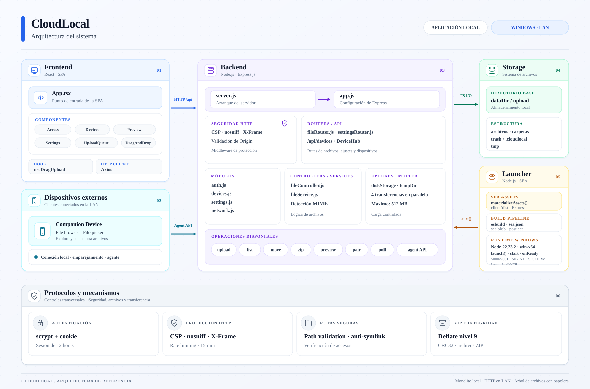

# CloudLocal — Servidor de archivos local privado

**Un ejecutable pone en marcha tu nube local; los demás equipos entran desde el navegador.** Los archivos quedan en el ordenador servidor, que debe permanecer encendido y despierto. No se necesitan clientes, códigos de vinculación ni otra aplicación en Ubuntu, móviles u otros ordenadores para subir, consultar y descargar archivos.



---

## Descripción

CloudLocal es un servidor de archivos local privado que se ejecuta como un único ejecutable portátil. Ofrece una interfaz web completa con:

### Interfaz de usuario

- **Sidebar** con navegación por secciones (Archivos, Papelera, Configuración)
- **Navegación de carpetas** con breadcrumbs y botón de retroceso
- **Tabla de archivos** con columnas de nombre, detalles y acciones
- **Vista en cuadrícula** y vista en lista (alternable)
- **Selección múltiple** con clic o Ctrl+A
- **Barra de selección** inferior con acciones rápidas
- **Búsqueda** en la carpeta actual

### Operaciones de archivos

- **Drag & Drop externo**: sube archivos arrastrándolos desde el explorador del sistema
- **Drag & Drop interno**: mueve archivos y carpetas arrastrándolos sobre carpetas destino
- **Copiar / Cortar / Pegar**: Ctrl+C, Ctrl+X, Ctrl+V para duplicar o mover entre carpetas
- **Renombrado inline**: F2 para renombrar archivos y carpetas directamente
- **Nueva carpeta**: botón en toolbar o Ctrl+Alt+N para crear carpetas
- **Vista previa** de imágenes, vídeo y audio en modal con cierre por Escape o click exterior
- **Iconos visuales** por extensión: miniaturas de imágenes y frames de vídeo en lista y cuadrícula, iconos de tipo para PDF, Office, código y más
- **Papelera** con restauración (vía botón en UI)
- **Descarga individual** de archivos y descarga ZIP (vía API)

### Apariencia y accesibilidad

- **Modo oscuro**: toggle grande y visible, persistencia en localStorage, detección automática del tema del sistema, sincronización instantánea entre pestañas
- **Indicadores de foco**: `:focus-visible` visible en todos los controles interactivos (3px solid accent, offset 2px)
- **Atajos de teclado**: Ctrl+A (seleccionar todo), Ctrl+C (copiar), Ctrl+X (cortar), Ctrl+V (pegar), Ctrl+Alt+N (nueva carpeta), F2 (renombrar), Delete (a papelera), Escape (cerrar modal/renaming)
- **Diseño responsive**: adaptado para escritorio, tablet y móvil
- **Accesibilidad**: skip-link, roles ARIA, navegación completa por teclado

---

## Instalación

### Descargar desde Releases

Descarga el ZIP de tu plataforma desde la página de Releases y extrae **todo** su contenido en una
carpeta: <https://github.com/AlexisVarela2811/CloudLocal/releases/latest>.

| Sistema | Archivo (patrón) | Contenido del ZIP |
|---|---|---|
| Windows x64 | `<versión>-rc.<n>-windows-x64.zip` | `CloudLocal.exe` |
| macOS (Apple Silicon) | `<versión>-rc.<n>-darwin-arm64.zip` | `CloudLocal.app` |
| Linux x64 | `<versión>-rc.<n>-linux-x64.zip` | `cloudlocal-linux-x64`, `CloudLocal.desktop`, `cloudlocal.png`, `install.sh` |

Ejemplo con la versión 0.1.4: `0.1.4-rc.1-linux-x64.zip`. Cada release publica además un archivo
`<archivo>.zip.sha256` por cada ZIP, y dentro del ZIP un `SHA256SUMS` con el hash de cada archivo.

**Arquitecturas disponibles**: solo `darwin-arm64` (macOS Apple Silicon) y `linux-x64` (Linux
x86-64), además de `windows-x64`. No se publican builds para macOS Intel ni para Linux ARM
(por ejemplo Raspberry Pi); en esos casos hay que compilar desde el código fuente.

#### Windows (x64)

1. Ejecuta `CloudLocal.exe`. El servidor funciona en segundo plano, sin consola.
2. El navegador se abre automáticamente en el equipo servidor; configura una contraseña de entre 12 y 256 caracteres en la pantalla inicial.
3. En **Configuración → Servidor → Conectar otros dispositivos**, copia la dirección. Ábrela desde otro equipo conectado a la misma red e inicia sesión.

#### macOS (Apple Silicon)

1. Abre `CloudLocal.app` (doble clic, o `open CloudLocal.app` desde Terminal).
2. Si macOS bloquea la app, consulta [Si ves una advertencia](#si-ves-una-advertencia).
3. El navegador se abre en el equipo servidor; configura la contraseña y usa **Configuración → Servidor → Conectar otros dispositivos** para el resto de equipos.

#### Linux (x64)

1. Ejecuta `./cloudlocal-linux-x64`. El ZIP conserva el permiso de ejecución; si tu extractor lo
   pierde, aplica `chmod +x cloudlocal-linux-x64`.
2. Opcional: `./install.sh` instala sin `root` en `~/.local` (binario `cloudlocal`, entrada de menú
   `.desktop` e icono). `./install.sh --uninstall` deshace la instalación.
3. El navegador se abre en el equipo servidor; configura la contraseña y usa **Configuración → Servidor → Conectar otros dispositivos** para el resto de equipos.

### Notas de uso

- **Solo red local.** CloudLocal usa HTTP sin cifrar y no está pensado para Internet. No publiques el puerto en el router, en un proxy público ni en un túnel; úsalo en tu LAN.
- **El equipo servidor debe permanecer encendido y despierto**, con CloudLocal en ejecución. Los archivos viven en su disco.
- **Los demás equipos entran con la IP de Configuración**: abre en el navegador la dirección que muestra **Configuración → Servidor → Conectar otros dispositivos** (por ejemplo `http://192.168.1.20:80`), usando el puerto real si es distinto de 80.
- **La configuración inicial solo se permite desde el propio equipo servidor.** Si el navegador no se abre, visita `http://127.0.0.1:80` (o el puerto real) en ese equipo.
- **Se apaga con "Apagar"**: espera a que terminen las transferencias y pulsa **Apagar** en la barra lateral, o **Configuración → Servidor → Apagar el servidor**. Se cierra únicamente la instancia que atiende esa dirección, no otros procesos de Node.
- **Para reiniciar**, ejecuta otra vez el binario o la app y recarga la página; tus archivos y contraseña se conservan. Consulta [Detener y reiniciar](docs/server-launcher.md#detener-y-reiniciar).

### Si ves una advertencia

Los binarios de CloudLocal no llevan firma de código de pago: no hay Authenticode en Windows ni
notarización de Apple en macOS. Las advertencias del sistema son esperables; elige según tu
criterio y verifica la integridad antes de ejecutar.

**Windows — SmartScreen ("Windows protegió tu PC")**

1. Comprueba el SHA-256 del ZIP descargado (ver más abajo).
2. En el diálogo, **Más información → Ejecutar de todas formas**. También puedes desbloquear el
   archivo antes de ejecutarlo: clic derecho → **Propiedades** → **Desbloquear** → **Aplicar**.
3. El binario no está firmado con Authenticode, por lo que SmartScreen no puede identificar al editor.

**macOS — Gatekeeper ("no se puede abrir porque proviene de un desarrollador no identificado" o "está dañada")**

El `.app` va firmado de forma *ad-hoc* (sin certificado de Apple ni notarización). Tras la descarga,
macOS añade el atributo de cuarentena:

```sh
xattr -dr com.apple.quarantine CloudLocal.app
open CloudLocal.app
```

Alternativas por interfaz: clic derecho sobre `CloudLocal.app` → **Abrir** → **Abrir**, o
**Ajustes del Sistema → Privacidad y seguridad → Abrir igualmente**. El mensaje "dañada" tras
mover la app también se resuelve con `xattr -dr com.apple.quarantine`.

**Verificar el SHA-256**

Compara el hash del ZIP con el contenido del archivo `.zip.sha256` de la misma Release. Cada
sistema tiene su comando:

```sh
# Linux
sha256sum 0.1.4-rc.1-linux-x64.zip
# macOS
shasum -a 256 0.1.4-rc.1-darwin-arm64.zip
```

```bat
rem Windows (PowerShell o CMD)
certutil -hashfile 0.1.4-rc.1-windows-x64.zip SHA256
```

Dentro del ZIP, `SHA256SUMS` repite el mismo control para sus archivos: `sha256sum -c SHA256SUMS`.
Un checksum demuestra integridad (que el archivo llegó completo y sin cambios), **no** identidad
del editor ni autenticidad.

**Compilar desde el código**

Si prefieres no ejecutar binarios descargados —o tu arquitectura no está publicada—, construye el
artefacto en tu equipo: consulta [Desarrollo (desde el código fuente)](#desarrollo-desde-el-código-fuente).

### Desarrollo (desde el código fuente)

#### Requisitos

- [Node.js](https://nodejs.org/) 22.12 o posterior con npm
- Un editor con soporte TypeScript y React (VS Code recomendado)

#### Construcción del candidato local

```sh
# 1. Instalar dependencias (workspaces client + server, luego launcher)
npm ci
cd launcher
npm ci
cd ..

# 2. Instalar navegador para tests E2E (si se ejecutarán tests de navegador)
npx playwright install chromium

# 3. Compilar frontend (TypeScript + Vite)
npm run build:frontend

# 4. Ejecutar tests (server + client + launcher)
npm test

# 5. Construir ejecutable portátil
npm run build:exe
```

#### Lanzar servidor + cliente embebido

```sh
cd server
npm start            # Sirve API + frontend embebido en http://localhost:5000
```

#### Desarrollo independiente de React

```sh
cd client
npm run dev          # Inicia Vite en http://localhost:5173 con HMR
```

### Otros componentes

| Componente | Descripción |
|---|---|
| `server/` | API REST (Node.js) que gestiona el sistema de archivos |
| `client/` | Interfaz web React con TypeScript + TailwindCSS |
| `launcher/` | Empaquetado portátil (Node.js SEA) — produce el artefacto de cada plataforma: `CloudLocal.exe`, `CloudLocal.app` o el binario Linux |

---

## Arquitectura

```
┌──────────────────────────────────────────────────────────────────────┐
│                               Red LAN                                │
│                                                                      │
│  ┌────────────┐                        ┌──────────────────────────┐  │
│  │ Navegador  │ HTTP /api ────────────►│ server/ · Express        │  │
│  │ SPA React  │                        │ API JSON + estáticos     │  │
│  │ client/dist│◄─────── SSE /api/events│ SPA (client/dist)        │  │
│  └────────────┘                        │ (launcher: Node SEA)     │  │
│  ┌────────────┐                        │                          │  │
│  │ Móvil /    │ HTTP ─────────────────►│                          │  │
│  │ otro equipo│                        │ dataDir                  │  │
│  └────────────┘                        │  ~/.cloudlocal/files     │  │
│                                        │  .cloudlocal/trash · tmp │  │
│                                        │ stateDir                 │  │
│                                        │  ~/.cloudlocal/state     │  │
│                                        └──────────────────────────┘  │
│                                                                      │
│ un proceso · HTTP sin cifrar · solo en la LAN                        │
└──────────────────────────────────────────────────────────────────────┘
```

### Server (`server/`)

API REST con autenticación basada en cookie (scrypt + token de sesión). Gestiona:

- Listado y navegación de carpetas
- Subida de archivos con barra de progreso (máximo 4 subidas simultáneas; por encima responde `429`)
- Descarga y vistas previas
- Papelera (borrado temporal, restauración, eliminación permanente y vaciado)
- Configuración de carpeta de datos
- Eventos en vivo por SSE (`/api/events`) para refrescar el listado sin recargar
- Límite de intentos de inicio de sesión: 5 fallos por IP en una ventana de 15 minutos; a partir de ahí responde `429`
- Cierre graceful del servidor HTTP

### Client (`client/`)

Aplicación React con TypeScript organizada en:

- `App.tsx` — Orquestación principal (auth, routing, estado, shortcuts de teclado)
- `components/Access.tsx` — Pantalla de autenticación (acceso con contraseña)
- `components/Details.tsx` — Inspector de un elemento seleccionado
- `components/MultiDetails.tsx` — Resumen de selección múltiple
- `components/FileVisual.tsx` — Iconos y miniaturas por tipo de archivo
- `components/Preview.tsx` — Modal de vista previa (imágenes, vídeo, audio, PDF)
- `components/Settings.tsx` — Configuración y toggle de modo oscuro (toggle grande, 64px ancho)
- `components/DragAndDrop.tsx` — Overlay de arrastrar y soltar (subida externa)
- `components/UploadQueue.tsx` — Cola de subida con progreso y retry/cancel
- `hooks/useDragUpload.ts` — Hook para arrastrar archivos externos
- `hooks/useSSE.ts` — Conexión `EventSource` a `/api/events`
- `api/api.ts` — Cliente HTTP Axios (todos los endpoints)
- `workspace.mjs` — Utilidades (formateo, breadcrumb, tipado de preview)

### Launcher (`launcher/`)

Bundler que combina servidor + frontend en un ejecutable portátil usando Node.js SEA (Single-Executable Application). Cada sistema construye su propio artefacto en `launcher/dist/`:

| Plataforma | Artefacto | Empaquetado de la Release |
|---|---|---|
| Windows x64 | `CloudLocal.exe` | ejecutable con icono `.ico` incrustado |
| macOS (Apple Silicon) | `cloudlocal-darwin-arm64` | dentro de `CloudLocal.app` con `Contents/Resources/CloudLocal.icns`, firma ad-hoc y [entitlements](launcher/resources/darwin-entitlements.plist) |
| Linux x64 | `cloudlocal-linux-x64` | binario más `CloudLocal.desktop`, `cloudlocal.png` e `install.sh` |

El detalle de la Release multiplataforma está en [Notas de la versión 0.1.4](docs/release-0.1.4.md).

---

## API — Endpoints

### Autenticación

| Método | Endpoint | Descripción |
|---|---|---|
| `POST` | `/api/setup` | Configurar contraseña inicial (solo localhost) |
| `POST` | `/api/login` | Iniciar sesión con contraseña |
| `POST` | `/api/logout` | Cerrar sesión |
| `GET` | `/api/session` | Estado de sesión actual |

> **Cookie**: `cloudlocal_session` (HttpOnly, SameSite=Strict, 12 h). Todas las peticiones API requieren esta cookie.

### Archivos

| Método | Endpoint | Descripción |
|---|---|---|
| `GET` | `/api/files` | Listar archivos (`?folder=&q=`) |
| `POST` | `/api/folders` | Crear carpeta (`{folder, name}`) |
| `POST` | `/api/files/upload` | Subir archivo multipart (`?folder=`) |
| `DELETE` | `/api/files` | Enviar a papelera (`?path=`) |
| `POST` | `/api/files/copy` | Copiar archivo/folder (`{from, to}`) |
| `POST` | `/api/files/move` | Mover archivo (`{from, to}`) |
| `POST` | `/api/files/moveFolder` | Mover carpeta (`{from, to}`) |
| `POST` | `/api/files/paste` | Pegar del portapapeles interno (`{from, to, type}`) |
| `POST` | `/api/files/permanent` | Eliminación permanente (`{id}`) |
| `GET` | `/api/files/zip` | Descargar como ZIP (`?paths[]=`) |
| `GET` | `/api/files/content` | Obtener contenido (`?path=`, `?inline=1` para ver en el navegador) |
| `GET` | `/api/files/preview/*` | Miniatura de imagen (`*` = ruta relativa; responde `400` si no es una imagen) |

### Papelera

| Método | Endpoint | Descripción |
|---|---|---|
| `GET` | `/api/trash` | Listar archivos en papelera |
| `POST` | `/api/trash/:id/restore` | Restaurar archivo |
| `POST` | `/api/trash/empty` | Vaciar papelera (todos) |

### Estado

| Método | Endpoint | Descripción |
|---|---|---|
| `GET` | `/api/status` | Espacio en disco, límite de subida, URLs |
| `GET` | `/api/session` | Estado de sesión actual |
| `GET` | `/api/events` | Stream SSE (`text/event-stream`) con los eventos `upload`, `folder`, `paste`, `move`, `copy`, `trash` y `restore` |

### Configuración

| Método | Endpoint | Descripción |
|---|---|---|
| `GET` | `/api/settings` | Obtener configuración |
| `PUT` | `/api/settings` | Guardar carpeta (`{folderPath}`) |
| `DELETE` | `/api/settings` | Restablecer carpeta por defecto |

### Shutdown

| Método | Endpoint | Descripción |
|---|---|---|
| `POST` | `/api/shutdown` | Apagar el servidor (requiere sesión) |

---

## Variables de entorno

| Variable | Descripción | Valor por defecto |
|---|---|---|
| `HOST` | Interfaz de red a escuchar (no `CLOUDLOCAL_HOST`) | `0.0.0.0` |
| `CLOUDLOCAL_PORT` | Puerto HTTP principal del servidor | `5000` |
| `PORT` | Alternativa a `CLOUDLOCAL_PORT` (solo server standalone) | `5000` |
| `CLOUDLOCAL_FALLBACK_PORT` | Puerto de respaldo si el principal falla | `5000` |
| `CLOUDLOCAL_DATA_DIR` | Ruta de la carpeta donde se almacenan los archivos | `.cloudlocal/files` |
| `CLOUDLOCAL_STATE_DIR` | Ruta del directorio de estado y credenciales | `.cloudlocal/state` |
| `CLOUDLOCAL_MAX_UPLOAD` | Tamaño máximo de archivo en bytes | `536870912` (512 MiB) |

> El launcher (el ejecutable, `CloudLocal.app` o el binario Linux) fija `CLOUDLOCAL_PORT=80` automáticamente; no se necesita configurar.

---

## Funcionalidades destacadas

### Sidebar

Panel lateral fijo con navegación rápida a Archivos, Papelera y Configuración. Incluye indicador de estado del servidor (en línea/desconectado) y botón para cerrar sesión. Por debajo de 768 px de ancho deja de ocupar espacio: se oculta y se abre como panel deslizable con el botón de menú del topbar y un overlay para cerrarlo.

### Navegación de carpetas

- **Breadcrumbs**: ruta actual clickeable (`/ > documentos > fotos > 2025`)
- **Botón de retroceso**: flecha izquierda para volver a la carpeta padre
- **Doble clic en carpetas**: navega directamente dentro

### Tabla de archivos

Vista tabular con columnas de nombre, tamaño/modificación y acciones (vista previa, descarga, eliminar). Las carpetas son navegables con clic; los archivos muestran acciones contextuales. Soporta vista en lista y vista en cuadrícula (alternable con botón en toolbar).

### Drag & Drop externo

Arrastra archivos desde el explorador del sistema directamente a la ventana para subirlos. Se muestra un overlay con confirmación visual. La barra de progreso aparece en la esquina inferior derecha.

### Drag & Drop interno

Arrastra un archivo o carpeta sobre otra carpeta para moverlo directamente. La carpeta destino se resalta para indicar que es un punto de drop válido.

### Copiar, cortar y pegar

Selección múltiple con clic o Ctrl+A. Copiar (Ctrl+C) y cortar (Ctrl+X) al portapapeles interno. Pegar (Ctrl+V) en la carpeta actual. Las operaciones se procesan en serie.

### Renombrado inline

Selecciona un archivo y pulsa F2. El nombre se convierte en un campo editable. Pulsa Enter para confirmar o Escape para cancelar. La validación incluye:
- No permitir nombres vacíos
- No permitir duplicados en la carpeta
- No permitir nombres de sistema (`CON`, `PRN`, `NUL`, etc.)

### Atajos de teclado

| Atajo | Acción |
|---|---|
| `Ctrl+A` | Seleccionar todo |
| `Ctrl+C` | Copiar al portapapeles |
| `Ctrl+X` | Cortar (mover) al portapapeles |
| `Ctrl+V` | Pegar en carpeta actual |
| `Ctrl+Alt+N` | Nueva carpeta |
| `F2` | Renombrar elemento seleccionado |
| `Delete` | Enviar a papelera |
| `Escape` | Cerrar modal, cancelar renaming |
| `Tab` | Navegación entre controles (focus visible) |

> `Ctrl+N` no se intercepta (queda para el navegador). Solo `Ctrl+Alt+N` crea carpetas.

### Vista previa

- **Imágenes**: se muestra en un modal con fondo oscuro. Cierre con Escape o clic fuera. La imagen se escala al viewport.
- **Vídeo**: reproductor HTML5 integrado.
- **Audio**: reproductor de audio HTML5.
- **PDF**: se abre en una nueva pestaña del navegador.

### Papelera

- **Mover a papelera**: Delete (seleccionados) o botón eliminar
- **Restaurar**: botón "Restaurar" en la UI (restaura al path original)
- **Eliminación permanente**: acción por elemento en la vista de papelera
- **Vaciar papelera**: botón "Vaciar papelera" (borra todos los elementos de forma definitiva)

### Modo oscuro

Actívalo en la sección Configuración mediante un toggle grande (64×34px) con track y thumb. Se guarda en `localStorage` (`cloudlocal-theme: "dark"` / `"light"`), se detecta automáticamente si el sistema operativo usa tema oscuro, y se sincroniza instantáneamente entre todas las pestañas abiertas vía `storage` event. Las variables CSS se aplican mediante `data-theme` en el `<html>`.

### Diseño responsive

| Breakpoint | Comportamiento |
|---|---|
| `> 1024px` | Sidebar fijo; tabla con todas las columnas |
| `769px – 1024px` | Sidebar fijo; se oculta la columna de tamaño |
| `≤ 768px` | Sidebar fuera de pantalla (se abre con el botón de menú y overlay); se ocultan las columnas de tamaño y modificación |
| `≤ 480px` | Igual que la anterior, con el panel más estrecho (260 px) y la cuadrícula en 3 columnas |

---

## Contribución

### Guía para desarrolladores

#### Estructura del proyecto

```
CloudLocal/
├── server/           # API REST (Node.js)
│   ├── src/          # server.js, storage.js, router, controller
│   └── test/         # Tests unitarios
├── client/           # Frontend React (TypeScript + Vite)
│   ├── src/
│   │   ├── api/      # Cliente HTTP Axios (api.ts)
│   │   ├── components/
│   │   │   ├── Access.tsx        # Pantalla de acceso
│   │   │   ├── Details.tsx       # Inspector de un elemento
│   │   │   ├── MultiDetails.tsx  # Resumen de selección múltiple
│   │   │   ├── FileVisual.tsx    # Iconos y miniaturas por tipo
│   │   │   ├── DragAndDrop.tsx   # Overlay de drag & drop
│   │   │   ├── Preview.tsx       # Modal de vista previa
│   │   │   ├── Settings.tsx      # Configuración y toggle dark mode
│   │   │   └── UploadQueue.tsx   # Cola de subida con progreso
│   │   ├── hooks/
│   │   │   ├── useDragUpload.ts  # Hook de drag & drop
│   │   │   └── useSSE.ts         # Eventos en vivo desde /api/events
│   │   └── App.tsx         # Orquestación principal
│   └── public/
├── launcher/         # Empaquetado portátil (Node.js SEA)
│   └── src/
│       ├── main.cjs
│       ├── runtime.cjs
│       └── tray.cjs
└── docs/             # Notas de versión y documentación de la API
```

#### Flujo de trabajo

1. Clona el repositorio y abre la carpeta raíz
2. Instala dependencias: `npm ci` desde la raíz; después, `cd launcher`, `npm ci` y `cd ..`
3. Compila `client` con `npm run build:frontend`
4. Ejecuta tests con `npm test`
5. Ejecuta `server` con `npm start` (desde `server/`)
6. Para desarrollo React en caliente: `npm run dev` en `client/`
7. Construye el ejecutable con `npm run build:exe`

#### Convenciones

- **TypeScript**: strict mode habilitado. No uses `any` salvo necesidad documentada.
- **Componentes React**: funcionales con hooks. Nombres `PascalCase`.
- **CSS**: TailwindCSS como base, variables CSS personalizadas para theming.
- **Comentarios**: en español. JSDoc para funciones exportadas.
- **Tests**: unitarios en `test/` por componente.
- **Commits**: estilo [Conventional Commits](https://www.conventionalcommits.org/).

#### Validación antes de push

```sh
# Compilar cliente (TypeScript + Vite)
npm run build:frontend

# Enlaces, anclas y que cada endpoint documentado exista en server/src
npm run check:docs

# Ejecutar tests (server + client + launcher)
npm test
```

#### Crear un cambio

1. Crea una rama descriptiva: `feat/nueva-funcion` o `fix/problema-descriptivo`
2. Implementa y verifica con los tests
3. Commit con mensaje convencional: `feat(client): add dark mode toggle`
4. Push y abre Pull Request

---

## Documentación adicional

- [Servidor portable y configuración](docs/server-launcher.md)
- [API y autenticación](docs/api.md)
- [Notas de la versión 0.1.4](docs/release-0.1.4.md)
- [Notas de la versión 0.1.0](docs/release-0.1.0.md)
- [Notas de la versión 0.0.1](docs/release-0.0.1.md)